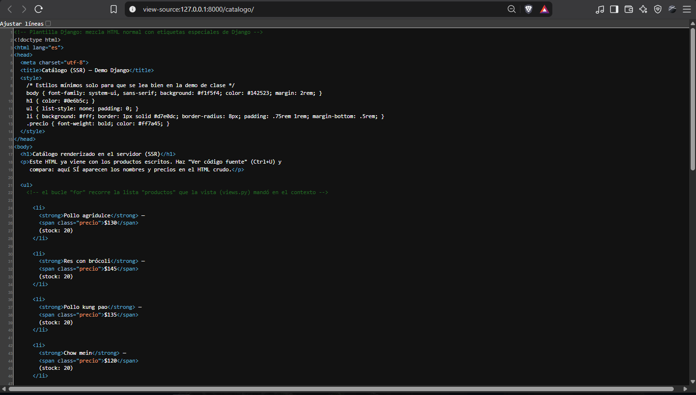
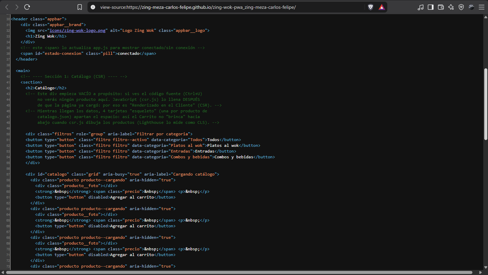

# Nombre de tu negocio — PWA de ventas

| Dato | Valor |
|---|---|
| **Alumno** | Zing Meza Carlos Felipe |
| **Grupo** | ING10-1 |
| **Negocio · giro** | Zing Wok · Comida china al wok |
| **URL del repositorio** | https://github.com/Zing-Meza-Carlos-Felipe/zing-wok-pwa_zing-meza-carlos-felipe |
| **URL de GitHub Pages** | https://zing-meza-carlos-felipe.github.io/zing-wok-pwa_zing-meza-carlos-felipe/ |

## Historial de avances

| Avance | Hash del commit entregado | Fecha |
|---|---|---|
| 1 | 91e03b4             | 11/10/2026 |
| 2 | 1e011d4             | 18/10/2026 |
| 3 | (hash del avance 3) | 25/10/2026 |
| 4 | (se escribe en el reporte PDF) | 01/11/2026 |

## Comparación SSR vs CSR

### SSR (Django): los productos llegan escritos en el HTML

### CSR (JavaScript): el div del catálogo llega vacío
