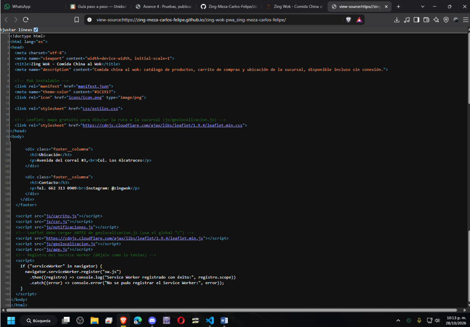
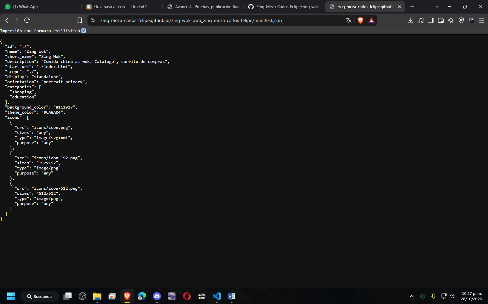
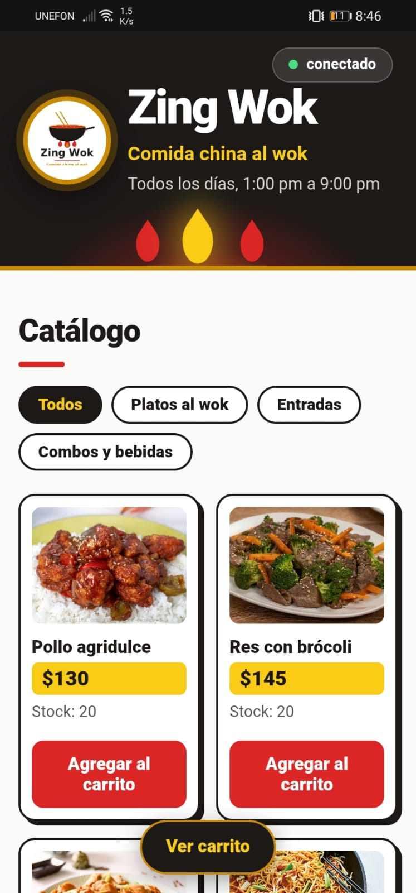

# Zing Wok — PWA de ventas

| Dato | Valor |
|---|---|
| **Alumno** | Zing Meza Carlos Felipe |
| **Grupo** | ING10-1 |
| **Negocio · giro** | Zing Wok · Comida china al wok |
| **URL del repositorio** | https://github.com/Zing-Meza-Carlos-Felipe/zing-wok-pwa_zing-meza-carlos-felipe |
| **URL de GitHub Pages** | https://zing-meza-carlos-felipe.github.io/zing-wok-pwa_zing-meza-carlos-felipe/ |

## Historial de avances

| Avance | Hash del commit entregado | Fecha |
|---|---|---|
| 1 | 91e03b4             | 11/10/2026 |
| 2 | f31a53e             | 18/10/2026 |
| 3 | bea5a95             | 25/10/2026 |
| 4 | (se escribe en el reporte PDF) | 01/11/2026 |

## Comparación SSR vs CSR

### SSR (Django): los productos llegan escritos en el HTML

### CSR (JavaScript): el div del catálogo llega vacío

## Funciones PWA (avance 3)

### index.html: manifest y registro del Service Worker activos

### sw.js: Workbox precachea el catálogo y las fotos

## Versión publicada (avance 4)

### index.html en GitHub Pages

### manifest.json en GitHub Pages

### Mi app instalada en el celular

### Guia de instalacion de la app para celulares:

La app se puede instalar directo desde el navegador desde esta URL:
https://zing-meza-carlos-felipe.github.io/zing-wok-pwa_zing-meza-carlos-felipe/

#### Android (Chrome)

1. Abrir **Chrome** en celular y entrar a la URL de GitHub Pages.
2. Esperar a que cargue el catálogo con sus fotos. Con eso el Service Worker queda registrado y la app ya se puede instalar.
3. Tocar el menú de **tres puntos (⋮)** que está arriba a la derecha.
4. Seleccionar **"Instalar app"** (en algunas versiones aparece como **"Agregar a la pantalla principal"**).
5. En el mensaje de confirmación presionar **"Instalar"**.
6. El ícono de **Zing Wok** aparecera en la pantalla de inicio y en el cajón de aplicaciones.
7. Lo seleccionamos para abrirla. Se ve a pantalla completa, sin la barra de direcciones del navegador, como una app normal.

#### iPhone (Safari)

> En iPhone la instalación solo funciona desde **Safari**. Si se abre la URL en Chrome u otro navegador, no aparece la opción.

1. Abrir **Safari** en iPhone y entro a la URL de GitHub Pages.
2. Esperar a que cargue el catálogo completo.
3. seleccionar el botón **Compartir** (el cuadrito con una flecha hacia arriba) en la barra inferior.
4. Deslizar el menú hacia abajo y seleccionar **"Agregar a pantalla de inicio"**.
5. Dejar el nombre **"Zing Wok"** (o puedes cambiarlo) y seleccionar **"Agregar"** arriba a la derecha.
6. El ícono de **Zing Wok** aparece en la pantalla de inicio.
7. Lo seleccionamos para abrirla. Se abre a pantalla completa, sin las barras de Safari.